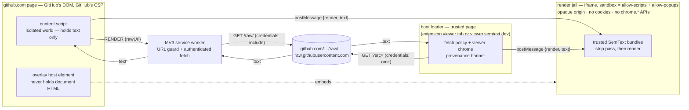

# Viewer & Extension — rendering SemText from GitHub

Status: design draft (no implementation) · 2026-10-13 · owner: Keith Brings

**Decided up front (requirements):** the hosted viewer is a **boot loader** — a page that fetches and displays a document, not a dumb iframe; the Chrome extension (MV3, Chrome Web Store) auto-renders `.html` blob views on github.com and offers a Render button on raw views; **GitHub Action / Pages publishing is out of scope** for this design.

## 1. Two surfaces, one renderer

1. **Hosted viewer** — `viewer.semtext.dev` is a boot loader: a static, credential-free page taking `?src=<https-url>`, fetching the file **as text** from an allowlist of origins (same-origin, `raw.githubusercontent.com`, `gist.githubusercontent.com`), and displaying it rendered. The page owns fetch policy and viewer chrome; rendering happens in the isolated render jail (§3).
2. **Chrome extension** — on github.com, `.html` (and `.htm`) blob pages auto-render in an in-page overlay; raw pages get a Render button that opens the rendered view. Both are user-configurable (D1): defaults are blob auto-render **on**, raw button-only.

Both surfaces run the same jail and the same trusted bundle set: `semtext-fallback.js` (+ `semtext-reading.js` where a document needs reader chrome, + the `semtext.js` Lit upgrade), theme CSS from `themes/`. No other code ever executes.

## 2. Architecture

## 3. Rendering mechanism — chosen

**Boot-loader page + sandboxed render jail whose top-level content is the SemText document, rendered by the trusted bundles.** The parent page embeds one iframe: `sandbox="allow-scripts allow-popups allow-popups-to-escape-sandbox"` — **never** `allow-same-origin` (with `allow-scripts` that pair lets a frame remove its own sandbox) and never `allow-top-navigation`. The parent never parses document HTML; it holds text only and passes it to the jail via `postMessage`. HTML parsing of untrusted text happens in exactly one place: inside the jail.

Why this over a bare top-level `<sem-text>`-style component in the boot-loader page:

- **Blast radius.** A strip-pass miss would execute with the *page's* origin — viewer.semtext.dev, or worse the github.com blob page where we cannot set CSP. In the jail it executes in an **opaque origin** with no cookies, no DOM reach, no APIs.
- **Portability.** The blob overlay lives inside github.com's page under GitHub's CSP. The sandbox attribute is the only guarantee that travels with us. One mechanism everywhere = one code path to audit.
- The jail still hosts the component tree — `<sem-enhanced-document>` is upgraded by the trusted bundles exactly as on the site — so interactivity (`view-as` switching, quizzes, reader chrome) is preserved.

## 4. Security model

**4.1 Execution policy.** The only code that runs is the viewer's own pinned bundle set: store-packaged IIFEs in the extension (MV3 forbids remote code; updates go through store review) and same-origin, SRI-hashed bundles on viewer.semtext.dev. Documents carry **no code**: a document cannot select bundles, and script-looking content in it is stripped (4.2) before render.

**4.2 Strip pass** (runs inside the jail on every payload, defense in depth). Parse with `DOMParser` — its documents have scripting disabled, so nothing executes at parse time — then walk the tree *including* `<template>` content: remove `script`, `iframe`, `frame`, `object`, `embed`, `applet`, `base`, `link[rel=import]`, `meta[http-equiv=refresh]`; remove any attribute matching `^on`; remove URL attributes (`href`, `src`, `srcset`, `xlink:href`, `action`, `formaction`, `poster`, `data`, `background`) resolving to `javascript:`, `vbscript:`, or `data:text/html`. SemText vocabulary elements and `style=`/`<style>` survive (CSS does not execute in modern engines); remote loads inside CSS fall under the consent gate (4.5).

**4.3 CSP, two layers.** The **boot-loader pages** (hosted viewer, extension viewer tab) stay maximally strict: `default-src 'none'; script-src 'self'; style-src 'self' 'unsafe-inline'; img-src 'self' data:; connect-src 'self' https://raw.githubusercontent.com https://gist.githubusercontent.com; frame-src 'self'; require-trusted-types-for 'script'; base-uri 'none'; form-action 'none'` — `connect-src` mirrors the fetch allowlist; lit-html's built-in Trusted Types policy keeps the Lit path working. The **jail** carries a policy tuned for D2 (remote passive resources allowed, code never): `default-src 'none'; script-src https://viewer.semtext.dev; style-src https://viewer.semtext.dev 'unsafe-inline' https:; img-src https: data:; font-src https:; connect-src https://viewer.semtext.dev; frame-src https://viewer.semtext.dev; require-trusted-types-for 'script'; base-uri 'none'; form-action 'none'` — script comes only from the viewer origin (named host, since `'self'` is unreliable in opaque-origin documents), `connect-src`/`frame-src` reach nothing beyond the jail's own origin, and no consent can raise this ceiling above passive resources. In the extension, `frame.html` is declared under the manifest's `sandbox.pages` key: Chrome applies its sandbox CSP, and such pages cannot call `chrome.*` APIs — the 4.4 invariants are enforced twice. Extension boot-loader pages keep the MV3 default CSP — never loosened, no `eval`.

**4.4 What a rendered document cannot do.** Opaque origin means: no GitHub cookies readable or attachable (`document.cookie` is empty; cross-site credentialled fetch is refused), no github.com DOM access (cross-origin by construction), no `chrome.*` APIs (a sandboxed frame is not an extension context; MV3 sandboxed pages cannot call extension APIs), no top-page navigation, no storage shared with the viewer or GitHub. Links are rewritten to `target=_blank` and surface to the parent as `semtext:navigate`.

**4.5 Remote subresources — consent gate (D2).** Remote images, fonts, and stylesheets are allowed — passive resources only, never code — behind an explicit per-document consent step. Before painting, the trusted code scans the parsed tree (including `<style>`/`style=` CSS `url()`s, `srcset`, `@font-face`) for remote hosts; if any exist, the trusted surface (boot-loader page, or the content script's isolated world in the blob overlay) shows a prompt listing the **distinct hosts**, with **Allow once** (this render only) and **Always allow for this host** (persisted in `chrome.storage.sync`). Unapproved hosts' subresources are dropped at render; the jail CSP (4.3) remains the hard ceiling.

## 5. Threat model

| # | Threat | Attacker goal | Mitigations |
|---|---|---|---|
| T1 | Malicious `.html` in a repo; victim opens blob (auto-render) or raw | XSS on github.com: session cookies, DOM injection, CSRF | The github.com page never materializes document HTML — content script holds text, the DOM is built only in the jail. Opaque origin: no cookies, no same-origin DOM, no APIs. Strip pass beneath it. Worst case on a double failure: script runs in a null origin that can do nothing. |
| T2 | Malicious `.semtext`/`.html` in a PR; reviewer previews | Drive-by on reviewer, phishing UI, tracking beacons, DoS | Same jail as T1. Provenance banner ("rendered from `<owner>/<repo>@<ref>`") is drawn by the trusted boot-loader page and cannot be covered by jail content. Remote subresources fire only for hosts the user saw and approved in the D2 consent prompt (4.5); unapproved hosts are dropped — no silent beacons. Caps: 10 MB document, node-count and render-time budget. |
| T3 | Hostile `viewer.semtext.dev/?src=<attacker-url>` | Viewer as SSRF/CSRF probe (intranet GETs), credential relay, content laundering | https-only allowlist of fetch origins; `credentials: 'omit'` + `referrerPolicy: no-referrer` so nothing rides along; re-check the post-redirect final URL against the allowlist; size cap; and even hostile content renders only inside the jail — the viewer cannot be turned into arbitrary-script execution. |
| T4 | Renderer supply chain | Attacker code inside the "trusted" bundles | Bundles ship in the store package / same-origin with SRI; no CDN code path; size budgets CI-enforced today carry over. |

## 6. Extension — manifest & permissions (MV3)

Bundle: `content.js` (github.com + raw), `background.js` (service worker), `viewer.html` (boot-loader tab), `frame.html` + bundles (jail), manifest.

| Key | Why it is needed |
|---|---|
| `content_scripts` → `https://github.com/*` | Detect `.html` blob URLs, derive the `/raw/` URL, inject the Render button and the auto-render overlay host. |
| `content_scripts` → `https://raw.githubusercontent.com/*` | Render banner on raw `.html` pages. |
| `host_permissions` → `https://github.com/*` | Background `fetch('https://github.com/<o>/<r>/raw/<ref>/
', {credentials:'include'})`. Host permission makes the fetch first-party for cookies, so private repos work with zero setup. Cookie *values* are never read. |
| `host_permissions` → `raw.githubusercontent.com` | Public raw fetch for the extension viewer tab. |
| `permissions: ["storage"]` | `chrome.storage.sync` only: render toggles (D1) and always-allow subresource hosts (D2). |
| `options_ui` (or action popup) · `sandbox.pages` manifest keys | Options UI hosts the D1 toggles; `sandbox.pages` declares `frame.html` a Chrome-sandboxed page (own CSP, no `chrome.*` — 4.3/4.4). Neither adds a permission. |
| `web_accessible_resources` → `frame.html` + bundles, scoped to `github.com` and `raw.githubusercontent.com` | The blob overlay must embed the jail in the page; only these resources are exposed (minimal fingerprinting surface). |

**Deliberately not requested:** `tabs` (creating tabs needs no permission; we never read tab state), `cookies` (values never read), `scripting` (static registration suffices), `identity` (no OAuth), `<all_urls>`, `downloads`, `webRequest`.

## 7. Message flow

Blob view (auto-render):

1. Content script matches `github.com/<o>/<r>/blob/<ref>/<path>.html`, derives `…/raw/<ref>/<path>`, injects overlay host + Render control.
2. CS → service worker: `RENDER {rawUrl}`. SW validates against `^https://github\.com/[^/]+/[^/]+/raw/`, fetches with `credentials:'include'`, enforces the 10 MB cap, returns text or a typed error. Every failure (404-private, expired session, raw-endpoint change) is typed and surfaced — no silent fallback (D3).
3. CS embeds the jail iframe (`chrome-extension://<id>/frame.html`, WAR-exposed) and waits for `semtext:ready`.
4. CS → jail: `postMessage({type:'semtext:render', text, meta}, '*')` — the payload is untrusted-by-contract text; the jail checks `event.source === window.parent` and strips on receipt. If the parsed tree references remote subresource hosts, the jail asks (`semtext:consent {hosts}`); the trusted surface shows the D2 prompt and replies with the approved list; unapproved loads are dropped.
5. Jail → CS: `semtext:height` (auto-resize), `semtext:error`, `semtext:navigate {url}` (CS opens a new tab; the jail cannot top-navigate).

Raw view: Render button (default; raw auto-render can be enabled in options) → `chrome.tabs.create('viewer.html#<rawUrl>')` (hash, not query — nothing hits a server) → viewer page fetches (public via raw.githubusercontent.com; private via github.com/raw) → steps 3–5 with the viewer page as parent. Hosted viewer: identical, but the page itself fetches the allowlisted `?src=` with `credentials:'omit'`.

## 8. Private repos

- **Extension:** session-cookie fetch of `github.com/…/raw/…` (§6) — the same session that can open the file on github.com can fetch it raw. No PAT, no tokens stored, nothing at rest. `raw.githubusercontent.com` is never used for private content — it is CDN-served and rejects sessions. **Failure mode is explicit:** expired session, lost access, or a GitHub raw-endpoint behavior change yield a typed error in the viewer UI (sign-in prompt / retry) — never a silent fallback, never a credential prompt.
- **Hosted viewer:** the render path holds no credentials by design; private files get an "open with the extension" call-to-action.
- All processing is client-side in both cases; nothing is proxied through a server, so there is no server-side credential story to get wrong.

## 9. First testable slice

1. **M1 — hosted viewer core:** boot loader + jail + bundles rendering same-origin samples via `?src=/samples/*.html`; strip pass + CSP + subresource-consent prompt shipped; attack-canary corpus (script, `on*` handlers, `javascript:` URIs, `srcdoc`, template-wrapped variants) asserts zero execution. No extension needed.
2. **M2 — extension raw path:** Render banner on raw `.html` → viewer tab → public raw fetch → jail render. Clickable end-to-end on a real URL.
3. **M3 — blob auto-render + private:** overlay embed, auto-render (options toggle), cookie-authenticated `/raw/` fetch, typed failure UI.

Slice 1 = M1 + M2. Cypress e2e canaries go in `test/e2e/` alongside the existing suites.

## 10. Decisions — resolved by the user (2026-10-13)

- **D1 — Render behavior is user-configurable.** Render button on raw views; options toggle for blob auto-render; both persisted in `chrome.storage.sync`; defaults: blob auto-render **on**, raw button-only (§1, §6, §7).
- **D2 — Remote subresources allowed with consent.** All remote images/fonts/CSS permitted after a per-document prompt listing the distinct hosts (Allow once / Always allow for this host, stored in `chrome.storage.sync`); the jail CSP still forbids remote script and confines `frame-src`/`connect-src` to the jail's own origin (4.3, 4.5; T2 updated).
- **D3 — Private repos ride the user's own browser session.** If the user can open the file on github.com, the same session fetches it raw; no PAT, no secrets stored; failures are explicit errors with no silent fallback (§7, §8).

No decisions remain open.
